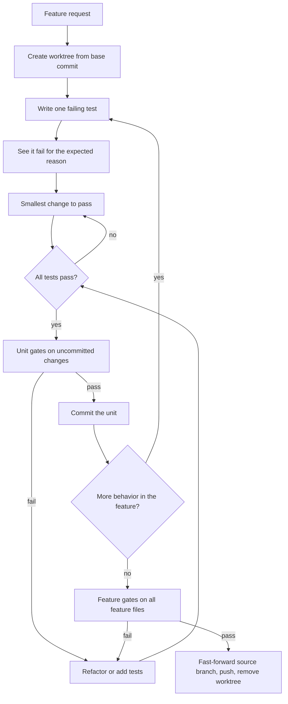

# lagom-mode-skill

Lagom is Swedish for "just enough, not too much".

lagom-mode is an agent skill that makes an AI coding agent stop when the work is done. It does not decide for itself when to stop. Three tools measure the code, and the same files always get the same verdict. The agent finishes only when every test passes and every tool passes. If it cannot get there in 5 tries, it stops and tells you why.

The skill is based on [ub-mode](https://github.com/unclebob/ub-mode) by Robert C. Martin. The tools are Rust ports of his [crapper](https://github.com/unclebob/crapper), [dryer](https://github.com/unclebob/dryer), and [mutator](https://github.com/unclebob/mutator). The ports need no Python.

## Why

An agent says "done" when it feels done, and that feeling changes from run to run. Then you must read the full diff to find complex functions, copied code, and tests that check nothing.

lagom-mode replaces the feeling with gates. A gate is a tool run and a fixed rule on its result. The rule gives pass or fail, and the agent cannot argue with it:

| Gate | It finds | It passes when |
| --- | --- | --- |
| Tests | Broken behavior | All tests pass. |
| `crapper` | Functions that are complex and not tested well | No function has a CRAP score over 9.99. |
| `dryer` | Code that repeats in a similar shape | No pair of functions scores 0.8 or more. |
| `mutator` | Tests that run the code but do not check it | Every mutant is killed, and no site is uncovered. |

The CRAP score is `CC² × (1 − coverage)³ + CC`, where `CC` is the number of paths through the function. A mutant is a copy of the code with one small change. A good test fails on it.

## The loop

The agent works on one small feature at a time, in its own Git worktree (a second checkout on its own branch). Other agents in the same repository do not change its results.



The gates run two times. The unit gates check each small step before its commit. The feature gates check all files of the feature at the end. They catch a problem that spans two steps, for example code in step 3 that copies code from step 1.

At the end, the agent fast-forwards the branch that you started from. It never makes a merge commit, and it never force-pushes. If something goes wrong, the agent stops and keeps the worktree, so you can look at it. `skills/lagom-mode/SKILL.md` lists every stop condition.

## Install

You need Git 2.30 or later, the Rust stable toolchain, and a C compiler.

1. Install the three tools:

   ```bash
   cargo install --git https://github.com/madsmadsen/lagom-mode-skill crapper
   cargo install --git https://github.com/madsmadsen/lagom-mode-skill dryer
   cargo install --git https://github.com/madsmadsen/lagom-mode-skill mutator
   ```

   The dryer build downloads a Python grammar from Git, so it needs network access. It does not need Python.

2. Make sure that the tools are on the `PATH`:

   ```bash
   crapper --help && dryer --help && mutator --help
   ```

3. Copy the four folders under `skills/` into the skill folder of your agent. For Claude Code, that folder is `~/.claude/skills/`.

   ```bash
   cp -R skills/lagom-mode skills/crapper skills/dryer skills/mutator ~/.claude/skills/
   ```

## Use

Ask your agent for a small feature, and tell it to use lagom-mode:

```text
/lagom-mode Add a `done <id>` command that marks a task as done.
```

The agent loads the tool skills by itself when it needs them. When it finishes or stops, it gives you a log of each action and the reason for it.

The tools also work without the skill. Run them in the root of a project:

```bash
crapper --changed --threshold 9.99    # CRAP scores of the changed files
dryer --changed --threshold 0.8       # similar pairs in the changed files
mutator --changed                     # mutation tests of the changed files
```

Each tool works on Clojure, Java, Go, TypeScript, JavaScript, Rust, and Python. The README of each tool lists its flags and exit codes.

## Repository

| Path | Content |
| --- | --- |
| `skills/lagom-mode/` | The main skill: the loop, the gates, and the rules of ub-mode. |
| `skills/crapper/`, `skills/dryer/`, `skills/mutator/` | One skill for each tool. It tells the agent how to run the tool and what to do about each result. |
| `tools/crapper/` | Rust port of crapper. See [its README](tools/crapper/README.md). |
| `tools/dryer/` | Rust port of dryer. See [its README](tools/dryer/README.md). |
| `tools/mutator/` | Rust port of mutator. See [its README](tools/mutator/README.md). |
| `docs/prd/` | The requirements: one document for each tool, and one for the skills. |
| `ci/linux-vm/` | Scripts that build and test the ports in Ubuntu guests with qemu. |

Each tool is its own Cargo project. No tool depends on another tool.

## Parity with the originals

Each port copies the behavior of the original at one pinned commit. The pin is in `tools/<tool>/parity/upstream.toml`. A parity runner runs the original and the port on the same small projects and compares the exit codes and the snapshots.

A port differs from its original only where `tools/<tool>/parity/fixes.toml` lists the difference. Each difference has a requirement and a test that fails on the original. For example, mutator runs a mutant a second time when it times out, and it limits the memory of each test run.

## Development

Read `AGENTS.md` before you change anything, and `CONTRIBUTING.md` before you run the code of a pull request. In short:

1. Write the failing test first, with the requirement ID in its name.
2. In the folder of the tool, run `cargo build --release`, `cargo test`, `cargo clippy --all-targets`, and `cargo fmt`.
3. Run the three gates on the files that you changed.
4. Add each action and its reason to the `LOG.md` of the tool.

## Status

The three tools pass their tests. The skills are written, but the acceptance runs that use an agent (the skills PRD, AC-2 to AC-13) are not done yet.

## License

Everything in this repository uses the MIT License. Copyright (C) 2026 Mads Madsen. See [LICENSE](LICENSE).

This work stands on the work of Robert C. Martin. ub-mode gave the rules, and crapper, dryer, and mutator gave the gates. Thank you, Robert. ub-mode uses the MIT License, and its notice is in [LICENSE](LICENSE) and in `skills/lagom-mode/LICENSE`.
