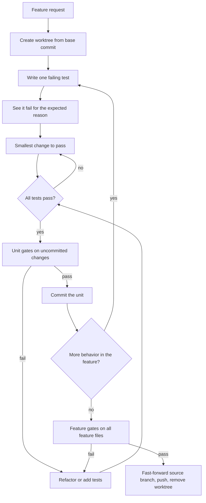

# PRD: Deterministic Coding Loop

Status: Draft 3. Owner and approver: Mads Madsen. Date: 2026-11-07.

This document states the requirements for the `deterministic-coding` repository. The repository holds two kinds of deliverables:

1. Agent skills that run a small, fixed loop to implement one small feature.
2. Rust versions of three quality-gate tools by Robert C. Martin: [crapper](https://github.com/unclebob/crapper), [dryer](https://github.com/unclebob/dryer), and [mutator](https://github.com/unclebob/mutator).

The main skill is based on [ub-mode](https://github.com/unclebob/ub-mode). Each statement that comes from a guess and not from a source carries the label `[ASSUMPTION]`. The owner must accept or replace each assumption before the review closes.

## 1. Problem

An AI coding agent decides by itself when its work is done. Its idea of "done" changes from run to run. A human must read the full diff to find complex functions, duplicated code, and code that the tests do not really check.

ub-mode answers this with a set of rules and three tools. The tools give the same verdict for the same files, so the agent cannot argue with them. The tools are written in Python today. Each tool needs a Python virtual environment, and mutator needs a `../crapper` checkout next to it. A Rust project then needs a working Python setup only to run its quality gates.

Agents that work in parallel in one checkout also see the changes of each other. A gate can then fail or pass because of a file that another agent changed.

## 2. Definitions

| Term | Meaning |
| --- | --- |
| Skill | A `SKILL.md` file that tells an agent how to do one kind of work. |
| Loop | The fixed sequence of steps that the main skill runs for one feature. |
| Unit | One behavior of the feature: one failing test and the code that makes it pass. |
| Gate | A tool run that gives pass or fail with no LLM involved. |
| Worktree | A Git working tree on its own branch, made with `git worktree add`. |
| Base commit | The commit that the loop worktree starts from. After a rebase (SK-17), the new tip of the source branch. |
| Source branch | The branch that was checked out where the loop started. |
| Feature files | The files that differ between the base commit and the worktree. |
| Original | The Python version of crapper, dryer, or mutator, at a pinned commit. |
| Port | The Rust version of one original. |
| Snapshot | An EDN file under `.metrics/` that a tool writes and uml-viewer reads. |
| EDN | Extensible Data Notation, the Clojure data format. |
| CRAP | Change Risk Anti-Patterns score: `CC² × (1 − coverage)³ + CC`. |
| CC | Cyclomatic complexity: the number of decision points in a function, plus one. |
| Mutant | A copy of the code with one small change, for example `<` to `<=`. |
| Survivor | A mutant that the tests do not detect. |
| Uncovered site | A mutation site on a line that no test runs. |
| Parity fixture | A small project in one language that the original and the port both analyze. |

In this document, "deterministic" means this: the same files on disk give the same gate verdict and the same snapshot each time. It does not mean that an LLM gives the same output each time.

## 3. Users

| User | Need |
| --- | --- |
| Developer | Asks an agent for a small feature and gets a change that passed every gate. |
| Agent | Gets clear steps, clear stop conditions, and tool output that it can act on. |
| Reviewer | Reads a short log and a few small commits, not a large unchecked diff. |
| uml-viewer user | Reads the same snapshots as before, now written by the ports. |

## 4. Goals

1. An agent that loads the main skill implements one small feature through a fixed loop and stops only when all gates pass.
2. Each loop runs in its own worktree, so changes by other agents do not affect its gates.
3. Each port is a drop-in replacement for its original: same command name, same flags, same exit codes, same snapshot format. The only differences are the bug fixes listed in section 12.
4. Each port supports the same six languages as its original: Clojure, Java, Go, TypeScript (with JavaScript), Rust, and Python.
5. In phase 3 (section 6.1), when all three ports replace their originals, the gates need no Python at run time, except to test a Python project.
6. The skills work in any agent that reads `SKILL.md` files, for example Claude Code, omp, Cursor, and Grok.

## 5. Non-goals

1. The repository does not port uml-viewer.
2. The ports do not add languages, metrics, or flags that the originals do not have.
3. The ports do not change the formulas or the thresholds of the originals. A bug fix is not a change of formula. Section 12 lists each bug fix.
4. The skills do not depend on features of one agent, for example subagents or plan tools.
5. The loop is for one small feature. It does not plan large projects or split epics.
6. The ports and skills are private. They are not published to crates.io or to a public skill registry.

## 6. Repository layout

```text
deterministic-coding/
  skills/
    feature-loop/SKILL.md  main loop skill, based on ub-mode
    crapper/SKILL.md       how to run crapper and act on the result
    dryer/SKILL.md         how to run dryer and act on the result
    mutator/SKILL.md       how to run mutator and act on the result
  crapper/                 Rust crate, binary `crapper`, library `crapper`
  dryer/                   Rust crate, binary `dryer`
  mutator/                 Rust crate, binary `mutator`, depends on the crapper library
  parity/                  parity fixtures and the parity test runner
  scripts/                 install-originals.sh for phases 1 and 2
  docs/PRD.md
```

The three crates are separate Cargo packages, not one workspace. mutator uses the `crapper` library crate through a Cargo path dependency. This replaces the `../crapper` checkout that the original mutator needs.

### 6.1 Delivery phases

The skills come first and use the Python originals. Each port then replaces its original when the port passes parity. The skills call the tools by command name, so the switch from an original to a port needs no change to a skill.

| Phase | Gate tools | Ends when |
| --- | --- | --- |
| 1 | All three originals | The crapper port passes parity. |
| 2 | A mix: each tool is the port if it passed parity, otherwise the original | All three ports pass parity. |
| 3 | All three ports | Not applicable. |

- PH-1: Until a port replaces its original, the skills use the original at the commit pinned in `parity/upstream.toml` (PB-1).
- PH-2: The skills call the tools only by the command names `crapper`, `dryer`, and `mutator`. A skill never calls `./crapper` or a path to a checkout.
- PH-3: The repository has a script, `scripts/install-originals.sh`, that clones the three originals at the pinned commits into one directory, with `crapper` next to `mutator`. The script puts a wrapper for each tool on the `PATH`. Each wrapper runs its original in the current directory. `[ASSUMPTION: script name and location]`
- PH-4: A port replaces its original only after it passes AC-1 for all six languages and Mads Madsen approves.
- PH-5: To switch a tool, the user removes the wrapper of the original from the `PATH` and installs the port (NFR-5). No skill changes.
- PH-6: The crapper port comes first, because the mutator port uses the crapper library (PT-19). The dryer port has no dependency and can come at any time.
- PH-7: The tool skills describe only the behavior that the original and the port share. A tool skill describes a bug fix from section 12 after the port with that fix replaces the original.
- PH-8: The development of this repository uses `feature-loop` with the tools of the current phase. The Rust code of the ports is gated by the Python originals until each port replaces its original.

## 7. The loop

The main skill runs these steps for one feature. The steps come from ub-mode. The skill adds the worktree, the order, and the stop conditions.



The loop runs the gates two times. The unit gates use `--changed`, which sees only uncommitted changes, so they run before each commit. The feature gates run at the end on the explicit list of feature files. This catches a problem that spans two units, for example duplication between code from unit 1 and code from unit 3.

## 8. Functional requirements: skills

Each requirement has an ID. Tests, specifications, and commits must refer to these IDs.

### 8.1 Format

- SK-1: Each skill is one `SKILL.md` file with YAML frontmatter that has `name` and `description`, the same format as ub-mode.
- SK-2: A skill must not need a tool or a feature that only one agent has.
- SK-3: The main skill names the three tool skills and tells the agent when to load each one.

### 8.2 Main skill: feature-loop

- SK-4: The main skill keeps the three phases of ub-mode, "First Make it Work", "Then Make it Right", and "Practice", and keeps each rule of ub-mode. One rule changes: ub-mode pushes to the main line at the end, and `feature-loop` integrates into the source branch (SK-16 to SK-18).
- SK-5: The main skill states the loop of section 7 as numbered steps, in that order.
- SK-6: The main skill tells the agent to write one failing test, run it, and record the failure reason before it changes production code.
- SK-7: A unit or a feature passes its gates when all of these are true at once:
  1. All tests pass.
  2. crapper reports no function with a CRAP score of 10 or more in the checked files.
  3. dryer reports no candidate pair with a score of 0.8 or more in the checked files.
  4. mutator exits `0` for the checked files, and the snapshot has 0 uncovered sites in the checked functions.
- SK-8: The unit gates check the uncommitted changes with these commands:
  1. `crapper --changed --threshold 9.99`
  2. `dryer --changed --threshold 0.8`
  3. `mutator --changed`
- SK-9: The feature gates check the feature files. The agent gets the list with `git diff --name-only <base-commit>` and passes it as positional arguments to the same three commands, without `--changed`.
- SK-10: The main skill sets a retry limit for each gate. If a gate still fails after the limit, the agent stops and reports the failure and the log. It does not lower a threshold, delete a test, or edit a gate command to pass. `[ASSUMPTION]` The limit is 3 tries for each gate.
- SK-11: The main skill tells the agent to keep a log of each action and its reason, and to report the log at the end.
- SK-12: The main skill tells the agent to commit each unit after its unit gates pass. Each commit message states why, what changed, and how the agent proved it.

### 8.3 Worktree

- SK-13: At the start of a loop, the agent records the source branch and the base commit, and creates a new worktree on a new branch from the base commit. `[ASSUMPTION]` The branch name is `feature-loop/<short-feature-name>`.
- SK-14: If the loop starts on a detached HEAD, the agent stops before it creates the worktree and asks for a source branch. `[ASSUMPTION]`
- SK-15: The agent makes every edit, test run, gate run, and commit inside the loop worktree. It does not change files in another worktree, except the fast-forward in SK-16.
- SK-16: After the feature gates pass, the agent fast-forwards the source branch to the loop branch with `git merge --ff-only`. It runs the command in the worktree that has the source branch checked out. It makes no merge commit. If the command fails because that worktree has uncommitted changes, the agent stops and reports.
- SK-17: If the source branch moved since the base commit, the agent rebases the loop branch onto the new tip of the source branch. Then it runs all tests and the feature gates again, and does SK-16 only if they pass. If the rebase has a conflict, the agent stops and reports.
- SK-18: If the source branch tracks a remote branch, the agent pushes the source branch after the fast-forward. If the remote rejects the push, the agent stops and reports. It does not force-push.
- SK-19: The agent records the worktree path, the loop branch, the source branch, and the base commit at the top of the log. It records each rebase and the new base commit.
- SK-20: After SK-16 and SK-18 succeed, the agent removes the loop worktree and deletes the loop branch. If the worktree has uncommitted changes, the agent does not remove it, and it reports the changes for a decision by the developer.
- SK-21: If the loop stops for any reason, the agent keeps the worktree and the loop branch and reports their names.

### 8.4 Tool skills

- SK-22: Each tool skill states how to install the tool in each phase: the original with `scripts/install-originals.sh` (PH-3), or the port with `cargo install --git` (NFR-5). It also states how to run the tool on uncommitted changes and on a list of files, and how to read its output.
- SK-23: The crapper skill maps a high score to an action: split the function, add tests, or both. It states when a `match` or `case` is worth splitting.
- SK-24: The dryer skill maps a candidate pair to an action: extract the shared shape, or record why the pair stays.
- SK-25: The mutator skill maps each outcome to an action: cover an uncovered site, kill a survivor with a new test, or delete dead code.
- SK-26: Each tool skill states the exit codes of its tool and what the agent does for each code.

## 9. Functional requirements: ports

### 9.1 Common to all ports

- PT-1: Each port is a Rust binary with the same name as its original: `crapper`, `dryer`, or `mutator`.
- PT-2: Each port accepts every flag and positional argument of its original at the pinned commit, with the same meaning and the same default.
- PT-3: Each port returns the same exit code as its original for the same input, except where a bug fix in section 12 says otherwise.
- PT-4: Each port writes its snapshot to the same path as its original, in the same EDN shape, with the same keys.
- PT-5: Each port detects the language of each file by extension, the same as its original.
- PT-6: Each port skips the directories `test`, `spec`, `vendor`, `node_modules`, and `target`, the same as its original.
- PT-7: Each port supports `--changed` with the same Git selection as its original.
- PT-8: Each port uses the same function and namespace naming for each language as crapper. The table in the crapper README is the reference.
- PT-9: Each port parses source with tree-sitter grammars for Java, Go, TypeScript, JavaScript, Rust, and Python, and with an EDN-aware Clojure reader for Clojure. `[ASSUMPTION]` The originals use tree-sitter for the same grammars.
- PT-10: The ports do not need Python, a virtual environment, or a checkout of another repository at run time. A Python project still needs Python to run its own tests.

### 9.2 crapper

- PT-11: The port computes `CRAP = CC² × (1 − coverage)³ + CC` per function.
- PT-12: The port counts decision points for each language with the rules in the crapper README, section "What each language counts".
- PT-13: The port reads coverage in each format of the original: Cloverage form counts, LCOV, JaCoCo XML, and the Go coverage profile.
- PT-14: The port runs the default coverage command for each language from the crapper README, section "Coverage commands", and supports `--coverage-command`, `--use-existing-coverage`, and `--no-coverage`.
- PT-15: If a coverage tool is missing, the port installs it the same way as the original. This covers `cargo-llvm-cov` for Rust, `@vitest/coverage-v8` in `node_modules` for Vitest without an edit to `package.json`, and `coverage` and `pytest` in the interpreter of the project for Python.
- PT-16: The port prints each tool install on stderr before it starts it.
- PT-17: The port prints the table worst score first and writes `.metrics/crap.edn`.
- PT-18: `--threshold N` makes the port exit `2` when the worst score is higher than `N`.
- PT-19: The crapper crate exposes a library API for function discovery, naming, coverage, and tool install. mutator uses this API.

### 9.3 dryer

- PT-20: The port normalizes each candidate form with the rules of the original: it keeps call names, method names, operators, and tree shape, and it drops local names, field names, literals, and keywords.
- PT-21: The port scores each pair with Jaccard similarity of structural fingerprints and compares forms only within one language.
- PT-22: The port selects candidate forms per language with the table in the dryer README, section "What each language compares".
- PT-23: The port supports `--threshold` (default 0.82), `--min-lines` (default 4), `--min-nodes` (default 20), `--format`, `--edn`, and `--text`.
- PT-24: The port writes `.metrics/dry.edn` and exits `0` after a report, `1` on a usage error, and `2` on an unknown `--format`.

### 9.4 mutator

- PT-25: The port applies the mutation rules for each language with the table in the mutator README, section "What each language mutates".
- PT-26: The port does not mutate tokens inside strings, comments, or quoted Clojure forms.
- PT-27: The port runs the baseline test command once before any mutant. If the baseline fails, the port exits `2` and does not change the snapshot.
- PT-28: The port counts a mutant as killed when the tests fail, time out, or do not compile. The timeout is the baseline time multiplied by `--timeout-factor` (default 10), with a minimum of 2 seconds.
- PT-29: The port skips sites on lines that the coverage report does not hit, and counts them as uncovered.
- PT-30: The port generates coverage and installs missing coverage tools through the crapper library, as PT-14 and PT-15 state.
- PT-31: The port runs mutants of one file in parallel worker directories under `target/mutation-workers`, with the overlay rules of the original. The original source files do not change.
- PT-32: The port restores files from `target/mutator-backup/` before a non-scan run, the same as the original.
- PT-33: The port runs differentially when a snapshot exists: it reruns survivors and every site in a function whose text changed. `--mutate-all` reruns all sites.
- PT-34: The port writes one snapshot per namespace to `.metrics/mutate/<namespace>.edn` and exits `0` when every executed mutant is killed, `2` when the baseline fails, and `3` when a mutant survives.

## 10. Non-functional requirements

- NFR-1: Determinism. Two runs of crapper or dryer on the same files with the same coverage report write byte-identical snapshots.
- NFR-2: Determinism for mutator. Two runs on the same files give the same outcome for each mutant, except a mutant whose test time is within 10% of its timeout. `[ASSUMPTION: 10%]`
- NFR-3: Speed. On each parity fixture, crapper with `--use-existing-coverage` and dryer each finish in less time than their original. `[ASSUMPTION]`
- NFR-4: Platforms. The ports build and run on macOS 14 or later (arm64 and x86_64) and on Linux x86_64 and arm64.
- NFR-5: Install. A user with read access to the private repository installs each port with one `cargo install --git` command.
- NFR-6: Licenses. The ports use the MIT License. The main skill keeps the MIT License notice of ub-mode. Each file that derives from an original names its source.
- NFR-7: Crash safety. If a mutator run stops because of a signal, the next run restores the source files from the backup, as PT-32 states.
- NFR-8: Isolation. Two loops that run at the same time in two worktrees of one repository do not change the gate results of each other.

## 11. Acceptance criteria

1. AC-1 (PT-2, PT-3, PT-4): For each parity fixture and each tool, the original and the port, run with the same flags, give the same exit code and the same snapshot after both are parsed as EDN. A difference that a bug fix in section 12 lists does not count as a failure.
2. AC-2 (PT-9): A parity fixture exists for each of the six languages and each of the three tools: 18 fixture runs in total.
3. AC-3 (PT-18): On a fixture with a worst score of 12, `crapper --threshold 10` exits `2` and `crapper --threshold 12` exits `0`.
4. AC-4 (SK-8): On a fixture with a worst score of exactly 10.0, `crapper --threshold 9.99` exits `2`.
5. AC-5 (PT-24): `dryer --format xml` exits `2`.
6. AC-6 (PT-27): On a fixture with a failing test, mutator exits `2` and the snapshot file keeps its previous bytes.
7. AC-7 (PT-31): After a mutator run, `git status` in the fixture shows no change to the source files.
8. AC-8 (PT-10): The parity fixtures for Clojure, Java, Go, TypeScript, and Rust pass on a host that has no Python installed, with the ports only.
9. AC-9 (PT-15): On a Rust fixture on a host without `cargo-llvm-cov`, crapper installs it, prints the install on stderr, and writes a snapshot with coverage values.
10. AC-10 (NFR-1): Two crapper runs and two dryer runs on each fixture write byte-identical snapshots.
11. AC-11 (SK-7, SK-10): An agent loads `feature-loop` and gets a small feature request on a sample Rust project. The agent ends with all four conditions of SK-7 true for the feature files, or with a stop report after the retry limit. Mads Madsen reviews the log for 3 sample features. `[ASSUMPTION: sample size]`
12. AC-12 (SK-9): In one sample feature, unit 1 and unit 3 add two functions that dryer scores 0.8 or more. The unit gates pass, the feature gates fail, and the agent removes the duplication before it pushes.
13. AC-13 (SK-13, SK-15, NFR-8): Two agents run two loops in one repository at the same time. Each loop log shows its own worktree, and no commit in one loop branch contains a file change from the other loop.
14. AC-14 (SK-16, SK-20): After a loop that passes, the source branch points to the last commit of the loop, the history has no merge commit, and `git worktree list` does not show the loop worktree.
15. AC-15 (SK-17): Another commit lands on the source branch while a loop runs. At the end, the log shows a rebase, a second run of the feature gates, and then the fast-forward.
16. AC-16 (SK-18): The remote rejects the push. The agent stops, the log names the rejection, and the remote branch is unchanged.
17. AC-17 (SK-2): The same 3 sample features complete in two different agents with no change to the skills.
18. AC-18 (PH-3): On a host with Python and no earlier setup, `scripts/install-originals.sh` runs once. After that, `crapper`, `dryer`, and `mutator` run the originals at the pinned commits from any project root, and `mutator` finds the crapper checkout.
19. AC-19 (PH-2, PH-5): The crapper port replaces the original. A sample feature then completes with no change to any file under `skills/`.

## 12. Parity baseline and bug fixes

The ports copy the behavior of each original at one pinned commit. The parity test runner runs both the original and the port on each fixture and compares the results. The ports fix known bugs of the originals and do not copy them.

- PB-1: The repository records the pinned commit of each original in `parity/upstream.toml`.
- PB-2: A change of the pinned commit needs a new parity run and an update of this section.
- PB-3: Each bug fix has an entry in `parity/fixes.toml` with the original, the upstream issue or a description, the changed behavior, and the parity fixture that shows the difference.
- PB-4: Each bug fix has a test in the port that fails on the behavior of the original and passes on the port.
- PB-5: A bug that comes from Python only, for example `bugs/python-tests-run-with-mutators-virtualenv.md` in mutator, needs no entry if the port cannot have it.
- PB-6: Mads Madsen approves each entry in `parity/fixes.toml`.

## 13. Success metrics

| Metric | Target | How to measure |
| --- | --- | --- |
| Parity fixture match rate, after listed fixes | 100% of 18 runs | AC-1 in CI |
| Features that reach "done" with no human edit | 70% `[ASSUMPTION]` | Logs of the sample features |
| Gate failures that the agent fixes inside the retry limit | 80% `[ASSUMPTION]` | Logs of the sample features |
| Python needed to run the gates on a non-Python project | No | AC-8 |

## 14. Risks

| Risk | Effect | Mitigation |
| --- | --- | --- |
| The originals change often. They have 31, 15, and 31 open issues. | The ports drift from the originals. | Pin one commit (PB-1). Update on purpose only (PB-2). |
| A bug fix in a port changes a result that uml-viewer users expect. | The viewer shows other numbers than before. | Each fix is listed and approved (PB-3, PB-6). |
| A tree-sitter grammar version in Rust differs from the one in Python. | Different parse trees give different CC, names, or fingerprints. | Pin the grammar versions. AC-1 detects a difference. |
| The Clojure reader in the original is custom Python code. | Edge cases of the reader are hard to copy. | Clojure parity fixtures cover reader conditionals, syntax-quote, and keyword calls. |
| Floats print in a different way in Rust and Python. | Snapshots differ in the last digits, for example `0.890909090909`. | Compare parsed EDN in AC-1. Copy the number format of the original for byte output. |
| The six coverage tool chains must exist on the CI host. | Parity runs are slow and fragile. | Use `--use-existing-coverage` with stored coverage reports in the fixtures for most runs. |
| The ports install tools into the environment of the user. | A global `cargo install` or a package in the Python interpreter of the project surprises the user. | PT-16 prints each install. The tool skills state which tools the ports can install. |
| Each worktree has its own `target/` directory. | The first build and the first coverage run in a new worktree are slow. | `[ASSUMPTION]` Accept the cost in version 1. A shared `CARGO_TARGET_DIR` is an option, but it can mix build output between loops. |
| The agent lowers a threshold or deletes a test to pass a gate. | False pass. | SK-10 forbids it. The reviewer reads the log and the diff of gate commands. |
| ub-mode and dryer use different defaults: 0.8 against 0.82. | The agent uses the wrong threshold. | SK-8 states `--threshold 0.8` in the command. |
| The source branch is checked out in another worktree that has uncommitted work by a developer or another agent. | A fast-forward there can fail, or can mix the loop changes with that work. | SK-16 uses `git merge --ff-only` in that worktree and stops if Git refuses. The agent never moves the branch ref with `git branch -f` or `git update-ref`. |
| The originals behave differently from the ports in each bug that section 12 fixes. | A gate result changes when a port replaces its original. | PH-4 needs parity first. PH-7 keeps bug-fix behavior out of the skills until the switch. `parity/fixes.toml` lists each difference. |
| An original has a bug that blocks the loop in phase 1. | The loop stops at the retry limit for a reason outside the feature. | The agent stops and reports (SK-10). The fix goes into the port, and the bug gets an entry in `parity/fixes.toml`. |

## 15. Dependencies

1. Rust stable toolchain and Cargo on the build host.
2. Git 2.30 or later on each host that runs a loop or `--changed`.
3. Read access to the private repository for each user who installs the ports.
4. For each language that a user analyzes: the test tools in the crapper and mutator READMEs. The ports install missing coverage tools (PT-15).
5. In phases 1 and 2: Python, in the version that the `pyproject.toml` of each original needs, and the originals at the pinned commits. In all phases: the originals for parity runs.

## 16. Decisions

| ID | Question | Decision |
| --- | --- | --- |
| Q-1 | Owner and approver | Mads Madsen. |
| Q-2 | Name of the main skill | `feature-loop`. The name `ub-loop` was rejected. |
| Q-3 | Publish the crates? | No. The repository is private. Install with `cargo install --git`. |
| Q-4 | Command for "under CRAP 10" | `crapper --threshold 9.99`. crapper fails only above the threshold, so 9.99 fails a score of 10.0 (AC-4). |
| Q-5 | Changed files or full project? | Each loop has its own worktree. Unit gates check uncommitted changes. Feature gates check all files that differ from the base commit. |
| Q-6 | Copy or fix known bugs of the originals? | Fix them, and list each fix in section 12. |
| Q-7 | Install missing coverage tools? | Yes, the same as the originals (PT-15). |
| Q-8 | Where does the loop push at the end? | Back to the branch it started from: fast-forward the source branch, and push it if it tracks a remote (SK-16 to SK-18). |

## 17. Open questions

None.
