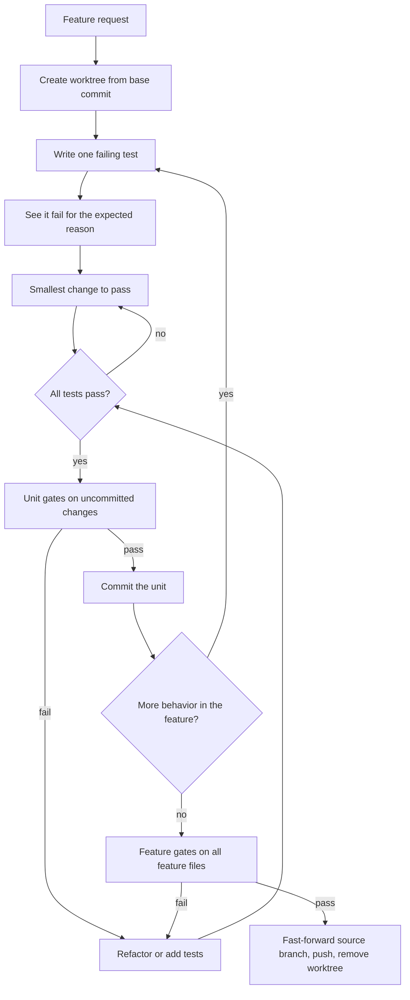

# PRD: lagom-mode skills

Status: Draft 2. Owner and approver: Mads Madsen. Date: 2026-11-21.

This document states the requirements for the agent skills in the `skills/` directory. The main skill, `lagom-mode`, makes an agent implement one small feature through a fixed loop with quality gates. It is based on [ub-mode](https://github.com/unclebob/ub-mode) by Robert C. Martin.

## 1. Problem

An AI coding agent decides by itself when its work is done. Its idea of "done" changes from run to run. A human must read the full diff to find complex functions, duplicated code, and code that the tests do not really check.

ub-mode answers this with a set of rules and three tools: crapper, dryer, and mutator. The tools give the same verdict for the same files, so the agent cannot argue with them.

Agents that work in parallel in one checkout also see the changes of each other. A gate can then fail or pass because of a file that another agent changed.

## 2. Definitions

| Term | Meaning |
| --- | --- |
| Skill | A `SKILL.md` file that tells an agent how to do one kind of work. |
| Loop | The fixed sequence of steps that `lagom-mode` runs for one feature. |
| Finish | The successful end of a loop: SK-14, SK-16, and SK-18 succeed. |
| Stop | The end of a loop after a failure: SK-9, SK-12, SK-14, SK-15, or SK-16. |
| Unit | One behavior of the feature: one failing test and the code that makes it pass. |
| Gate | A tool run and a fixed rule (SK-7) on its exit code and snapshot. The rule gives pass or fail and leaves no choice to the agent. |
| Worktree | A Git working tree on its own branch, made with `git worktree add`. |
| Source branch | The branch that was checked out where the loop started. |
| Base commit | The commit that the loop worktree starts from. After a rebase (SK-15), the new tip of the source branch. |
| Feature files | The files that differ between the base commit and the loop worktree. |

## 3. Goals

1. An agent that loads `lagom-mode` implements one small feature through a fixed loop. It finishes only when all gates pass. Otherwise it stops and reports.
2. Each loop runs in its own worktree, so changes by other agents do not affect its gates.
3. The skills work in any agent that reads `SKILL.md` files, for example Claude Code, omp, Cursor, and Grok.

## 4. Non-goals

1. The skills do not depend on features of one agent, for example subagents or plan tools.
2. The loop is for one small feature. It does not plan large projects or split epics.
3. The skills do not specify, build, or install the tools. They use the tools as commands.
4. Mads Madsen says that the repository is public on GitHub. This document does not check it. The skills are not published to crates.io or to a public skill registry.

## 5. The tools

The skills use three commands from the `PATH`: `crapper`, `dryer`, and `mutator`. A skill works with the Rust port of each tool, because the gates pass `--lines` to `crapper` and to `mutator` (SK-8). The Python crapper rejects that option (CR-26). The skills also run Git commands (SK-12 to SK-18). Git is a dependency (section 11), and its commands are not part of the tool interface. The skills depend only on this interface:

| Command | Used interface |
| --- | --- |
| `crapper` | `--lines <n,n,...>`, one file as a positional argument, `--threshold N`, `--changed`, and `--help` (CR-2, CR-7, CR-26). With `--lines`, `crapper` scores only the functions that contain one of the lines, and the exit status, the table, and the snapshot have only those functions (CR-26). Each item of `--lines` follows the rules of Python `int()` for ASCII digits, so `1_0` means line 10 (CR-26). Exit `0` when the worst CRAP score is `N` or lower, and `2` when it is higher than `N` (CR-17). Exit `1` on a usage error, on a value of `--lines` that is not a line number, and on a failure to read a file or a coverage report (CR-3, CR-26). A table on stdout with the worst score first (CR-16). A warning on stderr when the coverage tool failed (CR-13). The snapshot is `.metrics/crap.edn`, and each run replaces it (CR-4). A snapshot that cannot be written exits `1` (CR-3). Under `--changed`, a failed Git command exits with the code of Git, and a Git command that cannot start exits `1` (CR-7). crapper runs the coverage command of the project (CR-13) and installs a missing coverage tool from the network (CR-14). A run that selects no source file exits `0` (CR-3). crapper reads `lcov.info` only below `coverage/` and below `target/coverage/` of the project root, at any depth, and prints no warning when it finds no report there (CR-12). With no coverage command, the default Rust run writes the report to `target/coverage/rust/lcov.info`, or to `target/coverage/rust/<slug>/lcov.info` for a package below the root, and crapper reads it (CR-13). A report at another path gives every function a coverage of `0.0` (CR-10, CR-12). |
| `dryer` | `--changed`, a list of files or of substring filters as positional arguments, `--threshold N`, `--root`, `--format` with `text` or `edn`, and `--help` (DR-2, DR-7, DR-12). A positional argument that names no existing path acts as a substring filter on the paths, as the original does, and a filter can select no file (DR-2). A test path is scanned only when the skill names it (DR-6), and Rust test code stays out of the scan even when it is named (DR-15). A report of the candidate pairs at or above the threshold (DR-13). The snapshot is `.metrics/dry.edn`, and its `:candidates` holds the pairs. Each pair has its two forms in `:left` and `:right`, each with `:file`, `:start-line`, and `:end-line`, and its similarity score in `:score` (DR-4, DR-10). Exit `0` after a report, `1` on a usage error or when the snapshot cannot be written, `2` on an unknown `--format`, and `70` when the worker thread does not start or when it panics (DR-13). Under `--changed`, a failed Git command gives the exit code of Git (DR-13). A run that selects no source file exits `0` and writes no snapshot (DR-3, DR-4). A pair counts for the gate only when the `:start-line` to `:end-line` range of one of its two sides holds a changed line of that side's `:file` (DR-10, SK-7). A pair of two old forms does not count. The skill reads those three keys of each side and the changed lines of each file. |
| `mutator` | `--lines <n,n,...>`, one or more files or filters as positional arguments, `--scan`, `--no-coverage`, `--coverage-command`, `--max-workers N`, `--changed`, and `--help` (MU-2, MU-10, MU-17, MU-20). With `--lines`, `mutator` runs only the mutations on those lines, and one set of lines applies to every file in a run (MU-2). Each item of `--lines` follows the rules of Python `int()` for ASCII digits, so `1_0` means line 10, and an item that is not a positive line number exits `1` (MU-2, MU-20). A scan run lists the sites and runs no mutant (MU-2). `--no-coverage` treats every site as covered, so a snapshot shows no uncovered site (MU-2). `--max-workers N` sets the worker count, and the count is never more than half the cores (MU-17). Exit `0` when every executed mutant is killed and when it runs no mutant, `1` on a usage error, `2` when the baseline fails, and `3` when a mutant survives (MU-20). A failed `--coverage-command` gives the exit code of that command, and stderr names the code (MU-20). A run that exits `2` keeps the snapshots (MU-14). The snapshots are `.metrics/mutate/<namespace>.edn` (MU-4). Each form in `:forms` has `:file`, `:line`, `:end-line`, and the counts `:uncovered` and `:survived`, and `:outcomes` maps each mutation to `:killed` or `:survived`. A form without `:file` takes the `:source` of its snapshot (MU-4). Before a run that is not a scan run, mutator restores the files under `target/mutator-backup/` (MU-18). mutator installs a missing coverage tool from the network and prints the install on stderr before it starts (MU-11). A warning on stderr means that the coverage tool failed (MU-10). A notice on stderr means that no report covered the sites of that file (MU-16). mutator reads `lcov.info` only below `coverage/` and below `target/coverage/` of the project root, at any depth (MU-10). With no report there it counts every site as uncovered and exits `0` (MU-16). With no coverage command, the default Rust run writes the report to `target/coverage/rust/lcov.info`, and mutator reads it (MU-10). |

## 6. The loop

The steps come from ub-mode. `lagom-mode` adds the worktree, the order, and the stop conditions.

The loop runs the gates two times. The unit gates see only uncommitted changes, so they run before each commit. The feature gates run at the end on the feature files. In both, `crapper` and `mutator` check only the changed lines of each file (SK-8). This catches a problem that spans two units, for example duplication between code from unit 1 and code from unit 3.

## 7. Functional requirements

### 7.1 Format

- SK-1: Each skill is one `SKILL.md` file with YAML frontmatter that has `name` and `description`, the same format as ub-mode.
- SK-2: A skill must not need a tool or a feature that only one agent has.
- SK-3: `lagom-mode` names the three tool skills and tells the agent when to load each one.

### 7.2 Main skill: lagom-mode

- SK-4: `lagom-mode` keeps the three phases of ub-mode, "First Make it Work", "Then Make it Right", and "Practice", and keeps each rule of ub-mode. Two rules change. First, ub-mode pushes to the main line at the end, and `lagom-mode` integrates into the source branch (SK-14 to SK-16). Second, ub-mode reduces each function under CRAP 10, and `lagom-mode` reduces each function to CRAP 10 or lower (SK-7).
- SK-5: `lagom-mode` states the loop of section 6 as numbered steps, in that order.
- SK-6: `lagom-mode` tells the agent to write one failing test, run it, and record the failure reason before it changes production code.
- SK-7: A unit or a feature passes its gates when all of these are true at once:
  1. All tests pass.
  2. crapper reports no function with a CRAP score higher than 10 in the checked files.
  3. dryer reports no candidate pair with a score of 0.8 or more in the checked files in which the `:start-line` to `:end-line` range of one of the two sides holds a changed line of that side's `:file`. A pair of two old forms does not count.
  4. mutator exits `0` for the checked files, and the snapshots have 0 uncovered sites in the checked functions. The agent deletes the snapshot of the file before each run (SK-8). So a survivor can come only from a changed line.
- SK-8: `dryer` checks whole files. The unit gates run `dryer --changed --threshold 0.8`. The feature gates run `dryer --threshold 0.8` with the feature files as positional arguments, test files included. The agent gets the feature files with `git diff --name-only <base-commit>`. `crapper` and `mutator` check only the changed lines. In both gates, the agent runs `crapper --threshold 10 --lines <changed-lines> <file>` and `mutator --lines <changed-lines> <file>` once for each changed file that is not a test file. The agent skips a file that has no changed line, and a file that no longer exists. The agent does not use `--changed` for `crapper` or `mutator`. The agent runs one command for each file, because `mutator --lines` applies one set of lines to every file in a run. The agent does not run `crapper` or `mutator` on a test file, because the gate then fails or proves nothing for a reason that no repair clears. A test file is a file with a directory named `__tests__`, `spec`, `specs`, `test`, `testdata`, or `tests` anywhere in its path. It is also a file with a name like `*_test.go`, `*.test.ts`, or `test_*.py`. In Rust it is also a file named `*_tests.rs`, and a file `tests.rs` with `src` among its directories. Each tool skips a test file by default. `crapper` and `dryer` take a test file that the agent names, and `mutator` drops it. A named test file still goes into the `crapper` table, and a function of the file that the coverage report does not mention gets 0% coverage. The agent also reads the changed lines of each form of a dryer pair: dryer reports a pair only when the `:start-line` to `:end-line` range of one of its two sides holds a changed line of that side's `:file`, and a pair of two old forms does not count. The agent takes those lines from the same diff commands as the `--lines` values. In the unit gates, the agent takes the changed lines of a file from `git diff -U0 HEAD -- <file>`, and uses all lines of a new file that git does not track yet. In the feature gates, the agent takes them from `git diff -U0 <base-commit> HEAD -- <file>`. Get the changed lines from the hunk headers of the diff. A hunk header looks like `@@ -a,b +c,d @@`. The changed lines are `c` to `c+d-1`. If `,d` is missing, `d` is 1. If `d` is 0, the hunk only deletes lines. Use line `c` for it, unless `c` is 0. A hunk with `c` of 0 and `d` of 0 gives no line. Join the lines of all hunks of the file with commas. Before each `mutator` run on a file, the agent deletes each snapshot under `.metrics/mutate/` that holds a form whose `:file` is that file. A form without `:file` in an old snapshot takes the `:source` of that snapshot, so the agent deletes a snapshot whose `:source` is that file too. The snapshot path is `<namespace>.edn`, and the namespace parts become the directories, so `<crate-name>::foo::Bar` is `.metrics/mutate/<crate-name>/foo/Bar.edn` (MU-4). mutator writes that file again on the next run. Two checked files can share one snapshot. The agent deletes it once, then runs `mutator` on each file that shares it after the delete, and reads the gate result of each file right after its own run. A retry of one of those files repeats the delete, so it repeats the run of every checked file that shares the snapshot.
- SK-9: `lagom-mode` sets a retry limit of 5 tries for each gate. The count is separate for each gate of each unit and for each gate of the feature gates. The count restarts for each new unit and for the feature gates. A return to step 11 does not restart the count of tries of a gate. A try is one failed run of the gate after a change. The first failed run of a gate is try 1. The loop stops after the fifth failed run of a gate, and no sixth run of that gate follows. A run that passes uses no try, so a passing run after a rebase leaves the count as it was. A failed feature gate sends the loop back to step 7 and then to step 10. That return does not restart the count of the feature gates, and a unit that the fix adds has its own unit counts from step 3. A gate that fails after the rebase of step 11 counts as a failed run of that gate, and its fix returns to step 7 through the same rule. If a gate still fails after the limit, the agent stops and reports the failure and the log. It does not lower a threshold, delete a test, or edit a gate command to pass.
- SK-10: `lagom-mode` tells the agent to keep a log of each action and its reason, and to report the log at the end.
- SK-11: `lagom-mode` tells the agent to commit each unit after its unit gates pass. Each commit message states why, what changed, and how the agent proved it.
- SK-25: `lagom-mode` lists every stop condition in one numbered list: the retry limit of SK-9, the detached HEAD of SK-12, the failed fast-forward and the return limit of SK-14, the rebase conflict of SK-15, and the rejected push of SK-16. A stop report names its stop condition.

### 7.3 Worktree

- SK-12: At the start of a loop, the agent records the source branch and the base commit. It creates a new worktree on a new branch `lagom-mode/<short-feature-name>` from the base commit. If the loop starts on a detached HEAD, the agent stops before it creates the worktree and asks for a source branch.
- SK-13: The agent makes every edit, test run, gate run, and commit inside the loop worktree. It does not change files in another worktree, except the fast-forward in SK-14.
- SK-14: After the feature gates pass, the agent fast-forwards the source branch to the loop branch with `git merge --ff-only`. It runs the command in the worktree that has the source branch checked out. It makes no merge commit. If the command fails because that worktree has uncommitted changes, the agent stops and reports. If the command fails because the source branch moved after SK-15, the agent goes back to the rebase of SK-15. The agent can return 5 times. If the command fails for that reason after the fifth return, the agent stops and reports.
- SK-15: If the source branch moved since the base commit, the agent rebases the loop branch onto the new tip of the source branch. Then it runs all tests and the feature gates again, and does SK-14 only if they pass. If the rebase has a conflict, the agent stops and reports.
- SK-16: If the source branch tracks a remote branch, the agent pushes the source branch after the fast-forward. If the remote rejects the push, the agent stops and reports. It does not force-push.
- SK-17: The agent records the worktree path, the loop branch, the source branch, and the base commit at the top of the log. It records each rebase and the new base commit.
- SK-18: After SK-14 and SK-16 succeed, the agent removes the loop worktree and deletes the loop branch. If the worktree has uncommitted changes, the agent does not remove it, and it reports the changes for a decision by the developer.
- SK-19: If the loop stops, the agent keeps the worktree and the loop branch and reports their names.

### 7.4 Tool skills

- SK-20: Each tool skill names the document with the install instructions of its tool: the README of its port. It also states how to run the tool on uncommitted changes and on a list of files, and how to read its output.
- SK-21: The crapper skill maps a high score to an action: split the function, add tests, or both. It states when a `match` or `case` is worth splitting.
- SK-22: The dryer skill maps a candidate pair to an action: the agent extracts the shared shape. If the two forms look alike but mean different things, the agent changes one form so that its shape differs. A written reason alone does not pass the gate. If a counted pair stays at 0.8 or more, the gate fails and the retry limit of SK-9 applies.
- SK-23: The mutator skill maps each outcome to an action: cover an uncovered site, or kill a survivor with a new test. If no test can kill a survivor, the code is dead, and the agent deletes it.
- SK-24: Each tool skill states the exit codes of its tool and what the agent does for each code.

## 8. Non-functional requirements

- SK-NFR-1: Isolation. Two loops that run at the same time in two worktrees of one repository do not change the gate results of each other.
- SK-NFR-2: License. Each skill folder has a `LICENSE` file with the MIT License, Mads Madsen as the copyright holder, and an acknowledgment of Robert C. Martin. The `LICENSE` of `lagom-mode` also keeps the MIT License notice of ub-mode.

## 9. Acceptance criteria

The sample features run on the sample Rust project `samples/rust-todo`, a command-line to-do list, with the three tools on the `PATH`. Each run starts with a copy of `samples/rust-todo` as the root of a new Git repository with one commit, so the tools run in the root of the loop worktree as the skills say. The success runs of `docs/PRD.md` section 6 item 1 use two harnesses, Claude Code and omp, with no change to the skills between the two runs. The 5 sample feature requests are:

1. Add a `done <id>` command that marks a task as done.
2. Add a `--due <date>` option to `add`, and list overdue tasks first.
3. Add an `export --csv` command that writes all tasks as CSV.
4. Add a `delete <id>` command that removes a task.
5. Add a `--tag <name>` option to `add`, and a `--tag <name>` filter to `list`.

1. AC-1 (SK-1, SK-3, SK-4, SK-5, SK-20 to SK-25): `docs/skill-checklist.md` has one item for each of these requirements. Mads Madsen inspects the skills and records pass or fail for each item. All items pass.
2. AC-2 (SK-7, SK-9, SK-14 to SK-16, SK-25): An agent loads `lagom-mode` and gets a small feature request. The agent ends with all four conditions of SK-7 true for the feature files, or with one of the stop reports of SK-25. A stop report names its stop condition, and a stop after the retry limit of SK-9 reports the failure and the log. Mads Madsen reviews the log for the 5 sample features in each of the two harnesses, so for the 10 runs.
3. AC-3 (SK-6): In the log of each of the 10 runs, every unit has a run of its failing test, with the failure reason recorded, before the first change to production code in that unit.
4. AC-4 (SK-7, SK-8): In one sample feature, unit 1 and unit 3 add two functions that dryer scores 0.8 or more. Both functions are new lines, so one side of the pair holds a changed line and the pair counts. The unit gates pass, the feature gates fail, and the agent removes the duplication before it finishes.
5. AC-5 (SK-9): For each of the 10 runs, a script finds no change to a gate command or a threshold under `skills/`, and no deleted test file in the diff of the loop branch.
6. AC-6 (SK-12): A loop that starts on a detached HEAD stops before it runs `git worktree add`, and asks for a source branch.
7. AC-7 (SK-12, SK-13, SK-NFR-1): Two agents run two loops in one repository at the same time. Each loop log shows its own worktree, and no commit in one loop branch contains a file change from the other loop.
8. AC-8 (SK-14, SK-18): After a loop that finishes, the source branch points to the last commit of the loop, and the history has no merge commit. `git worktree list` does not show the loop worktree, and `git branch --list lagom-mode/*` does not show the loop branch.
9. AC-9 (SK-14, SK-19): The worktree that has the source branch checked out has uncommitted changes when the feature gates pass. The agent stops and reports, and the loop worktree and the loop branch still exist.
10. AC-10 (SK-15): Another commit lands on the source branch while a loop runs. At the end, the log shows a rebase, a second run of the feature gates, and then the fast-forward.
11. AC-11 (SK-15, SK-19): The rebase has a conflict. The agent stops and reports, and the loop worktree and the loop branch still exist.
12. AC-12 (SK-16): The remote rejects the push. The agent stops, the log names the rejection, and the remote branch is unchanged.
13. AC-13 (SK-18): The loop worktree has uncommitted changes after SK-14 and SK-16 succeed. The agent does not remove the worktree, and it reports the changes.
14. AC-14 (SK-8): In one sample feature, the agent changes one old file that holds a complex function that it does not touch, and adds one new file. The complex function is in `src/task.rs`, a file that a sample feature changes, and the feature does not touch the function. In the log of the unit gates, `crapper` and `mutator` run once for each of the two files, with `--lines` set to the changed lines of that file, or to all lines of the new file. The old complex function does not make the gate fail. No run uses `--changed` for `crapper` or `mutator`. A file with no changed line has no run. No run of `crapper` or `mutator` names a test file.

## 10. Risks

| Risk | Effect | Mitigation |
| --- | --- | --- |
| The agent lowers a threshold or deletes a test to pass a gate. | False pass. | SK-9 forbids it. AC-5 detects it. |
| ub-mode and dryer use different defaults: 0.8 against 0.82. | The agent uses the wrong threshold. | SK-8 states `--threshold 0.8` in the command. |
| The source branch is checked out in another worktree that has uncommitted work. | A fast-forward there can fail, or can mix the loop changes with that work. | SK-14 uses `git merge --ff-only` and stops if Git refuses. The agent never moves the branch with `git branch -f` or `git update-ref`. |
| Each worktree has its own build output and no installed dependencies. | The first build and the first coverage run in a new worktree are slow. | Accept the cost. |
| A tool has a bug that blocks the loop. | The loop stops at the retry limit for a reason outside the feature. | The agent stops and reports (SK-9). |

## 11. Dependencies

1. Git 2.30 or later on each host that runs a loop.
2. `crapper`, `dryer`, and `mutator` on the `PATH`, with the interface in section 5.
3. The test tools of the project that the agent works on.
4. The command names `crapper`, `dryer`, and `mutator` on the `PATH` belong to the Rust ports. The gates pass `--lines` to `crapper` and to `mutator`, and the Python crapper rejects that option (CR-26). A wrapper script that puts a Python original on the `PATH` under one of these names cannot run a gate.

## 12. Open questions

None.
